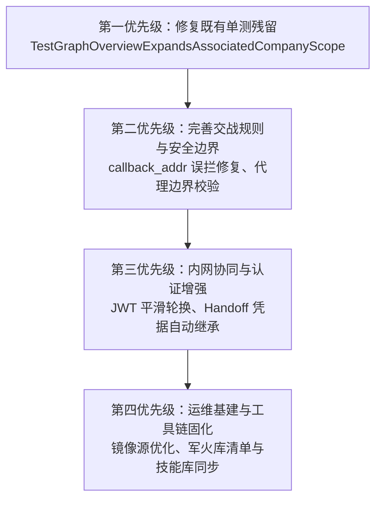

# ARTEX 待办任务清单

本文档整理了 ARTEX 在完成第 20 次拉取请求（PR #20：RoE 自动化提取 Shell 命令行目标主机）及带库验收并入主分支之后，系统当前遗留的技术债务、待完善功能与后续迭代规划。

---

## 一、核心缺陷与测试套件修复（高优先级）

### 1. 黑板关联企业范围继承用例失败
* **文件路径**：`agent/blackboard_inheritance_test.go`
* **涉及用例**：`TestGraphOverviewExpandsAssociatedCompanyScope`
* **问题描述**：该用例在执行时断言失败（错误信息为 `task scope missing: <nil>`）。在近期的多次功能提交中，该问题均作为既有残留跳过，未作专门修复。
* **目标**：排查任务图谱在黑板数据初始化时对关联企业授权范围（Company Scope）的解析与继承逻辑，修复空指针异常，使 `go test ./agent` 无需跳过参数即可全量通过。

---

## 二、交战规则（RoE）与安全防护机制

### 1. 出口防泄露门控中合法反连地址的误判优化
* **问题描述**：当前出口防泄露门控（Egress Guard）用于拦截任务执行过程中向外泄露敏感配置的行为，但平台本身合法的交互外带地址（如 `callback_addr`、反弹 Shell 接收地址）可能被判定为敏感字符串而遭到误拦。
* **目标**：在出口流量检查中建立针对平台自身监听与回连地址的识别与白名单放行逻辑，避免正常交互功能被误阻断。

### 2. 伪装门控（Camouflage Gate）的常态化启用
* **问题描述**：目前系统伪装门控在环境体检工具（`artex doctor`）及运行时中仍处于试验阶段，默认处于关闭状态，仅在显式声明环境变量 `ARTEX_GATE=1` 时才生效。
* **目标**：完善伪装门控的检测与旁路能力，完成稳定性评估后将其转为默认可用状态。

### 3. 蜜罐检测签名与联动响应深化
* **问题描述**：
  * 当前默认蜜罐特征库中部分规则（例如 OpenCanary FTP 泛特征）覆盖范围偏宽，存在将真实业务服务误判为蜜罐的风险。
  * 当前对蜜罐的判定以记录观测信息和告警（WARN）为主，尚未与任务决策流水线形成更深入的策略联动。
* **目标**：收紧并校准蜜罐规则特征库，降低误报率；完善识别到蜜罐后 Worker 智能体的规避与标记机制。

### 4. 代理与会话维度的边界校验统一
* **问题描述**：SOCKS 代理层目前尚未严格校验目标主机是否在授权范围内；同时 `register_session`（会话登记）与 `portfwd`（端口转发）在面对超范围目标时，内部缺乏统一规范的拒绝与拦截机制。
* **目标**：将 RoE 范围检查一致性贯穿到全局代理转发与立足点会话管理中。

---

## 三、认证体系与任务协作调度

### 1. JWT 令牌平滑轮换与无感刷新
* **问题描述**：当前服务的 JWT 鉴权依赖单次生成的固定密钥，缺乏周期性轮换与多版本并存过渡机制。若服务端刷新密钥，长时间运行的后台任务或前端长连接可能因令牌失效而中断。
* **目标**：设计支持多代密钥平滑过渡的 JWT 轮换与续期方案，保障客户端与服务端通信的连续性。

### 2. 外网到内网任务移交的凭据继承
* **问题描述**：目前外网渗透任务在向内网派生子任务（Task Handoff）时，已支持基本的任务上下文传递，但父任务收集到的有效凭据与授权信息在向子任务同步时，缺乏自动继承绑定和溯源台账机制。
* **目标**：打通跨任务移交时的凭据自动继承链路，确保内网任务初始化即具备前置任务已验证的凭据上下文。

---

## 四、运维部署与外部工具链

### 1. 容器构建与镜像源加速配置
* **问题描述**：Dockerfile 及部署镜像中尚未预置稳定的镜像源加速配置（如 APT_MIRROR、NodeSource 与 npm registry），在不同网络环境下全量构建速度波动较大。
* **目标**：提供可配置且具备合理默认值的构建镜像源选项，优化持续集成与离线部署体验。

### 2. 外部安全工具清单（Tools Manifest）完善与哈希校验
* **问题描述**：目前 `packaging/tools-manifest.json` 中部分提权、凭据提取及高级代理工具（如 mimikatz、laZagne、peass、suo5-payloads 等）出于环境轻量化考虑保持为按需选配，其 SHA256 哈希校验当前全部为空。
* **目标**：补齐核心推荐工具清单及其固定版本的 SHA256 签名，提升生产部署时的完整性校验能力。

### 3. 本地技能（Skills）库的整理与同步
* **问题描述**：工作区中针对部分技能（如 `scopesentry`、`playwright-cli`、`api-recon`）提示词及新扩展模块（`tbhm-app-analysis`、`tbhm-recon`）的更新尚未纳入版本管理。
* **目标**：对技能目录的改动进行规范审查、格式校对，并同步提交至代码仓库。

---

## 五、推进优先级建议

