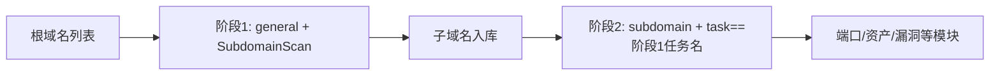

# ScopeSentry 常用工作流

## 1. 按项目查资产

当用户或上下文**已有项目条件**时，优先带上 `filter.project` 缩小范围，避免跨项目数据过多导致响应变慢。若无明确项目，可不强制加项目筛选。

1. `list_projects` 或 `list_projects_data` 获取目标项目的 **ObjectID**（`id` / `children[].value`）
2. `list_assets` 传入 `filter.project`（**必须是 ID，不能写项目中文名**）

```json
{
  "asset_type": "asset",
  "pageIndex": 1,
  "pageSize": 20,
  "search": "domain=^example.com",
  "filter": {
    "project": ["<项目ObjectID>"]
  }
}
```

## 2. 创建扫描任务

1. `list_nodes` 获取在线节点名称
2. `list_scan_templates` 或 `create_scan_template` 获取模板 **ObjectID**
3. `create_scan_task`：`name`、`node` 必填，`template` 填模板 ID（不能填模板名）

**目标来源 `targetSource`（与 Web 端一致）：**

| targetSource | 说明 | 必填参数 |
| --- | --- | --- |
| `general` | 直接输入目标 | `target` |
| `project` | 从项目读取目标 | `project`（项目 ObjectID 数组） |
| `asset` | 从 Web 资产库搜索 | `search`；可选 `project`、`filter`、`targetNumber` |
| `RootDomain` | 从根域名库搜索 | `search`；可选 `project`、`filter`、`targetNumber` |
| `subdomain` | 从子域名库搜索 | `search`；可选 `project`、`filter`、`targetNumber` |
| `UrlScan` | 从 URL 扫描结果搜索 | `search`；可选 `project`、`filter`、`targetNumber` |
| `*Source`（如 `subdomainSource`） | 从资产页「选中/搜索」创建 | `targetTp=search` 时用 `search`；`targetTp=select` 时用 `targetIds` |

**示例 — 直接扫根域名：**

```json
{
  "name": "example-子域名收集",
  "node": ["node-1"],
  "template": "<模板ObjectID>",
  "targetSource": "general",
  "target": "example.com\nfoo.com",
  "project": ["<项目ObjectID>"]
}
```

**示例 — 从子域名库续扫（按上一任务名筛选）：**

```json
{
  "name": "example-端口与漏洞",
  "node": ["node-1"],
  "template": "<后续模块模板ObjectID>",
  "targetSource": "subdomain",
  "search": "task==\"example-子域名收集\"",
  "project": ["<项目ObjectID>"]
}
```

## 3. 根域名完整信息收集（推荐两阶段）

当输入为**根域名**且要进行**完整信息收集**时，建议分两次扫描，不要一次跑全流水线。

**原因：** 分布式任务以**单个目标**为单位分发。根域名作为目标时，某节点分到该根域名后，在该节点上扫出的子域名也会继续在该节点执行后续模块，容易造成负载不均、速度慢、易出错。

**最佳实践：**

1. **第一阶段 — 仅子域名收集**
   - `targetSource`: `general`
   - `target`: 所有根域名（多行）
   - 模板：仅启用 `SubdomainScan`、`SubdomainSecurity`（子域名扫描 + 子域名接管）
   - 用 `get_task` 等待任务完成

2. **第二阶段 — 后续模块**
   - `targetSource`: `subdomain`
   - `search`: `task=="<第一阶段任务名称>"`（精确匹配任务名）
   - 可选 `project` 缩小范围
   - 模板：端口扫描、资产测绘、漏洞扫描等（可不含 SubdomainScan）
   - 子域名作为独立目标分发到各节点，并行效率更高

也可在 Web 界面「子域名」资产页按任务名筛选后，使用「从子域名创建任务」，效果相同。



## 4. 创建扫描模板

1. `list_plugin_modules` → 模块名列表
2. `list_plugins`（可按 `module` 过滤）→ 各插件 `hash` 与默认 `parameter`
3. `create_scan_template`：用 `modules` 指定「模块 → 插件 hash 数组」

**扫描模板全部模块名：**

`TargetHandler`、`SubdomainScan`、`SubdomainSecurity`、`PortScanPreparation`、`PortScan`、`PortFingerprint`、`AssetMapping`、`AssetHandle`、`URLScan`、`WebCrawler`、`URLSecurity`、`DirScan`、`VulnerabilityScan`、`PassiveScan`
