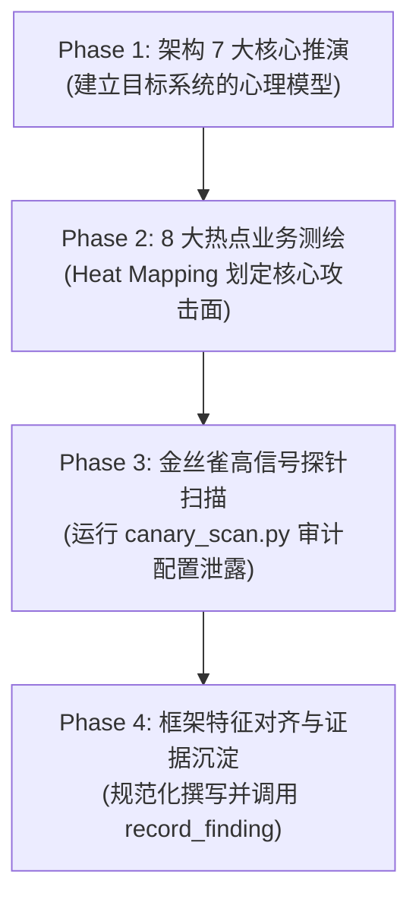

# TBHM Application Analysis（应用深度分析与热点测绘）

基于 Jason Haddix 经典的 **The Bug Hunter's Methodology [Core] 2026** 应用层深度测试方法论。
核心目标：**在盲目构造 Payload 之前，通过严密的 7 大架构推演与 8 大热点测绘，直击高概率产生严重漏洞的业务交互中枢。**

---

## 边界与纪律（Agent 必读）

| 阶段 | 允许操作 | 严格禁止 |
|---|---|---|
| **架构推演** | 请求头/响应体分析、身份凭证传递逆向、前端路由解析、技术栈指纹识别 | 暴力破解他人账户密码、大字典无差别扫描 |
| **热点测试** | 低噪声金丝雀探针、参数边界探测、反射输入无害标记验证、权限矩阵对比 | 破坏性注入测试、DROP TABLE、向生产环境写入恶意后门、破坏业务数据完整性 |
| **漏洞记录** | 当金丝雀探针命中敏感文件（如 `.env`, `.git/HEAD`, Actuator）时，提取证据并立即调用 `report_finding` | 凭空臆测无复现证据的漏洞、虚高漏洞危害等级 |

---

## 四阶段作业流水线



---

### Phase 1: 架构分层透视与 7 大核心问题 (Mental Model)

对分配到的具体 Web 资产，优先带着以下 7 个关键问题审查应用基础流量：

1. **数据如何传递？**（JSON、Form-data、XML、Protobuf 还是自定义编码？）
2. **如何标识用户身份？**（Cookie、JWT、Authorization Header 还是前端请求头中的 User ID？）
3. **是否存在多租户与多级角色？**（租户 ID 是如何由服务端鉴权约束的？前端路由是否展示了越权菜单？）
4. **业务独特的威胁模型是什么？**（这是金融交易、医疗隐私、SaaS 协同还是硬件控制台？核心资产数据是什么？）
5. **该系统历史暴露过哪些脆弱点？**（是否有旧版 CVE 依赖、第三方 COTS 采购组件历史漏洞？）
6. **底层框架的安全机制如何？**（是否使用了原生 ORM 防注入？模板引擎是 Jinja2、Twig 还是 Razor？是否启用了全局 CSRF Token？）
7. **数据如何存储与处理？**（关系型数据库、NoSQL、S3 对象存储还是本地临时文件？）

---

### Phase 2: 8 大高危热点测绘 (Heat Mapping Areas)

在流量抓包与应用探索中，将重点锚定在以下 8 个高产区：

| 热点编号 | 核心区域 | 审计重点 |
|---|---|---|
| **1** | **文件上传 (Uploads)** | 检查 MIME 类型校验、扩展名黑白名单、解压 Zip Slip、图片元数据 Exif 污染及 SVG 脚本执行。 |
| **2** | **响应 Content-Type 检查** | 寻找非标准 `text/html` 的返回包、检查 JSON 响应在特定浏览器下是否降级为 HTML 渲染导致 XSS。 |
| **3** | **API 与未文档化端点** | 关注 `/api/v1/user/1234` 等 IDOR 敏感点，寻找被注释或仅在 JS 中暴露的内测接口。 |
| **4** | **账户管理中心 (Account Area)** | 邮箱/手机换绑逻辑、密码重置 Token 强度、OAuth 回调地址校验及 2FA 绕过逻辑。 |
| **5** | **触发异常的请求 (Errors)** | 故意提交特殊符号 `'"`、畸形 JSON 观察报错，检查是否有堆栈追踪、数据库报错或模板报错泄露。 |
| **6** | **接收 URL/路径的参数** | 参数名包含 `url=`, `redirect=`, `path=`, `src=`, `endpoint=` 时，评估 SSRF、重定向与本地文件包含。 |
| **7** | **反射输入点 (Reflected Content)** | 关注 URL 查询参数、未过滤的请求头被直接回显到页面 DOM 的位置。 |
| **8** | **AI Chatbot 与 LLM 集成** | 审查提示词注入风险、内部私有知识库 RAG 敏感数据泄露及 Tool-calling 越权。 |

---

### Phase 3: 金丝雀高信号探针扫描 (Canary Scanning)

运行随 Skill 附带的高并发非破坏性探针脚本，对目标站点执行快速基线审计：

```bash
python3 ${SKILL_DIR}/scripts/canary_scan.py <target_url>
```

**探针覆盖的 5 大高危类别**：
1. **环境变量与密钥文件**：`/.env`, `/.env.local`, `/.env.prod`, `/application.yml`, `/config/master.key`
2. **版本控制历史暴露**：`/.git/HEAD`, `/.git/config`, `/.git/index`
3. **API 契约文档泄露**：`/swagger.json`, `/openapi.json`, `/v3/api-docs`
4. **调试与监控管理端点**：`/actuator/env`, `/actuator/heapdump`, `/_profiler/`, `/debug/pprof`
5. **备份与数据库转储**：`/backup.sql`, `/database.sql`, `/dump.sql`

---

### Phase 3.5: 定制内容发现词表（Custom Discovery Wordlist，按需）

当通用大字典漏报或识别出特定框架/组件技术栈时，结合目标响应头、框架特征与已提取的 JS 路径种子，在当前工作目录生成去重、排序后的定制词表 `custom_list.txt`，再交由 `ffuf` / `feroxbuster` 精准枚举（切忌只把通用字典抄一遍）。两阶段生成方法与排查维度见 `${SKILL_DIR}/references/content-discovery-wordlist.md`。

---

### Phase 4: 规范化证据与漏洞录入 (Report Finding)

一旦在金丝雀扫描、定制词表命中或热点测试中确认存在真实安全漏洞，**必须严格按以下标准结构记录证据并调用 `report_finding`**：

```markdown
# Technical Issue - [受影响资源与参数]
The resource `[接口/文件路径]` in parameter `[参数名]` is vulnerable to [具体漏洞类型].
When accessed:
* URL: https://target.com/path
Server responded with HTTP 200 containing [敏感环境变量/未授权数据/反射输出].

# Business Impact
[清晰阐述对业务数据与租户隔离造成的实际危害：凭证失窃 / 商业秘密泄露 / 系统接管]

# Reproduction
1. Send HTTP GET request to: https://target.com/path
2. Verify response headers & body contains: [关键回显内容]

# Evidence
[截取关键证据片段]
```

---

## 交付完成标准 (Definition of Done)

- [ ] 完成目标站点架构 7 问推演，形成基础认知。
- [ ] 标记出目标站点的 8 大热点交互区域（如上传点、API 列表、认证中心）。
- [ ] 运行 `canary_scan.py` 完成基础配置泄露与高危端点金丝雀审计（必要时生成 `custom_list.txt` 配合 `ffuf` 补测）。
- [ ] 所有确认的配置暴露或逻辑缺陷已按标准格式调用 `report_finding` 上报平台。

---

## 附加资源（按需读取，勿跳读）

| 文件 | 内容 |
|---|---|
| [reference.md](reference.md) | 技术参考手册：SSTI 万能探针与引擎确认表、反序列化格式特征识别、常见默认高危调试与管理端点、文件上传关键安全检查项（40+ 维度） |
| [references/content-discovery-wordlist.md](references/content-discovery-wordlist.md) | 按目标技术栈与 JS 路径种子构建定制 `custom_list.txt` 的两阶段流程（合并自原 `content-discovery-wordlist` 技能） |
| [scripts/canary_scan.py](scripts/canary_scan.py) | 高并发非破坏性金丝雀探针（Phase 3，5 大高危类别） |
| [scripts/quick-hits-wordlist.txt](scripts/quick-hits-wordlist.txt) | 快速命中路径字典（配合 canary_scan.py） |
