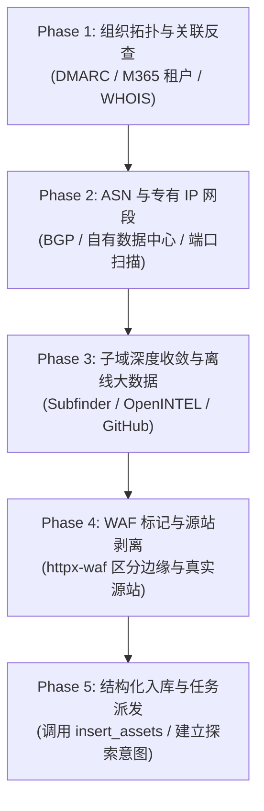

# TBHM Recon（资产侦察与组织测绘）

基于 Jason Haddix 经典的 **The Bug Hunter's Methodology [Core] 2026** 外部攻击面侦察方法论。
核心目标：**跳出单域名狭窄视野，发现竞争对手未覆盖的根域名、组织关联资产、ASN 自有网段与源站子域。**

---

## 边界与纪律（Agent 必读）

| 阶段 | 允许操作 | 严格禁止 |
|---|---|---|
| **Recon 范围** | DNS 查询、WHOIS 反查、BGP ASN 检索、证书库反查、子域被动聚合、WAF 指纹分析 | 未授权漏洞攻击、写入/修改操作、大流量拒绝服务端口泛洪 |
| **资产入库** | 将已验证归属的目标域名、CIDR 段、Web 端口写入 ARTEX 资产图谱 (`insert_assets`) | 将与目标无关的第三方 SaaS 共享服务（如 Cloudflare 公共 IP）误标为专属资产 |

---

## 五阶段作业流水线



### Phase 1: 组织拓扑与关联反查 (Organizational Apex Discovery)

1. **DMARC 逆向关联**：
   - 运行配套脚本提取目标域名邮件安全策略，挖掘 `rua`/`ruf` 聚合报告邮箱关联的所有集团子公司与海外站点：
     ```bash
     python3 scripts/live_dmarc_lookup.py <target-domain>
     ```
2. **Microsoft 365 / Exchange 租户枚举**：
   - 若目标使用 Office 365，调用 Exchange Autodiscover API 提取租户绑定的所有关联域名：
     ```bash
     curl -s "https://autodiscover-s.outlook.com/autodiscover/autodiscover.json/v1.0/<target-domain>?Protocol=Autodiscoverv1"
     ```
3. **反向 WHOIS**：
   - 提取注册人组织名、技术支持邮箱，使用反向 WHOIS 查找批量注册的主域名。

### Phase 2: ASN 自主系统与拥有 IP 段挖掘

1. **BGP 路由与 ASN 查找**：
   - 查询目标组织（如 `Company Name, Inc.`）对应的 ASN 编号（ASXXXXX）。
2. **IP 范围解析与资产管道**：
   - 使用 ASN 路由解析工具将 ASN 转为 CIDR 列表：
     ```bash
     echo "ASXXXXX" | asnmap -silent
     ```
3. **关键端口主动发现**：
   - 针对组织专有 IP 段扫描常见 Web 暴露端口（80, 443, 8080, 8443, 8888, 9000）：
     ```bash
     echo "ASXXXXX" | asnmap -silent | naabu -p 80,443,8080,8443,8888 -silent
     ```

### Phase 3: 子域名被动聚合与大数据提取

1. **无侵入多源被动搜集**：
   - 聚合多源 API 获取已知子域名：
     ```bash
     subfinder -d <target-domain> -all -silent
     ```
2. **OpenINTEL 5 年历史 DNS 大数据**：
   - 离线查询 Cisco Umbrella Top 1M 历史子域库（毫秒级提取 4000万+ 离线数据）：
     ```bash
     /home/skyler/下载/Telegram\ Desktop/The\ Bug\ Hunters\ Methodology\ \[Core\]\ 2026/openintel-subs-dist/openintel-subs-linux query -d <target-domain> -s
     ```
3. **GitHub 代码与子域刮取**：
   - 搜索组织代码库中暴露的内部研发子域（`internal.`, `dev-`, `stg-`, `api-`）。

### Phase 4: 存活探测与 WAF 指纹剥离

1. **探测存活并识别保护层**：
   - 使用内置 WAF 识别引擎的探测器区分真实源站与 CDN：
     ```bash
     cat all_subdomains.txt | httpx -title -status-code -tech-detect -silent
     ```
2. **识别目标标记分类**：
   - **`WAF/CDN`**（Cloudflare、Akamai、Imperva、AWS WAF）：标记为边缘防护资产。
   - **`App / Direct Origin`**（直连应用源站）：标记为**高优先级突破资产**，直接写入 ARTEX 深入分析意图。

### Phase 5: 结构化输出与 ARTEX 资产图谱同步

将清洗去重后的资产提交给 ARTEX 平台：
- 域名与子域：调用 `insert_assets`，类型设置为 `domain` 或 `subdomain`。
- IP 与段：类型设置为 `ip` 或 `cidr`。
- 探测到的 Web 站点：记录为 `site`，附带端口、标题与技术栈指纹。

---

## 交付完成标准 (Definition of Done)

- [ ] 完成根域名关联扩展（已检测 DMARC / 租户关联）。
- [ ] 导出已验证归属的顶级域与子域名去重列表。
- [ ] 识别并区分出已接入 WAF 与未接入 WAF（直连源站）的 Web 节点。
- [ ] 所有有效资产已写入系统资产图谱，形成下一步深入测试的输入清单。

---

## 附加资源（按需读取，勿跳读）

| 文件 | 内容 |
|---|---|
| [reference.md](reference.md) | 技术参考手册：ASN 探测语法、M365/Exchange 租户提取、Shodan 被动查询语法、DMARC 逆向关联查询、子域名爆破与变异、GitHub Recon Dorking 规则 |
| [scripts/live_dmarc_lookup.py](scripts/live_dmarc_lookup.py) | DMARC 记录在线提取（Phase 1） |
| [scripts/dmarc_recon.py](scripts/dmarc_recon.py) | DMARC 逆向关联深度分析（`rua`/`ruf` 邮箱挖掘） |
